# 📊 Documentación Completa y Galería Visual
## Reporte Centro de Contacto · Coord. Inteligencia de Negocios (GGMM)

> **Identificación Oficial:** Reporte Operativo del Centro de Contacto 0800  
> **Área:** Coordinación de Inteligencia de Negocios · Gerencia General de Mercadeo Hogares (GGMM)  
> **Período de Análisis:** Septiembre 2026 (22 días hábiles operativos)  
> **Muestra Auditada:** 1,826 interacciones  
> **Fecha de Elaboración:** 21/10/2026  
> **Enlace del Proyecto (GitHub):** [reporte-centro-contacto0800](https://github.com/sitecanva/reporte-centro-contacto0800.git)  
> **Enlace de Exportación:** [Revista Digital](https://sitecanva.github.io/reporte-centro-contacto0800/revista0800sep/)  
> **Documento Base de Trabajo:** [Informe Operativo en Google Docs](https://docs.google.com/document/d/1x3r3bTbMh5RCe4ckTuUSEXqVJm4i6YnuiOlVqdtpgj0/edit?usp=sharing)

---

## 🏗️ 1. Arquitectura y Stack Tecnológico

El reporte ha sido diseñado y construido bajo una arquitectura web ligera, responsiva y de carga ultra-rápida, con un diseño estético **Cyberpunk Neon Dark Glassmorphism**.

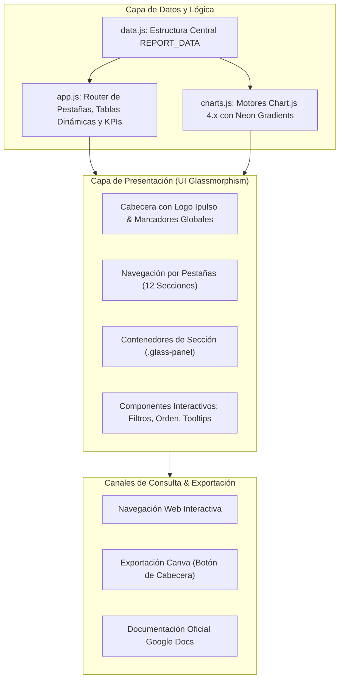

### Especificaciones de Diseño
- **Paleta de Colores Cyberpunk Neón:**
  - Fondo Primario: `#020b1f` (Dark Navy profundo)
  - Fucsia Neón: `#FF00A8` (Acentos de alta carga, alertas y puntos críticos)
  - Cyan Neón: `#66FFFF` (Identidad digital, métricas de volumen y FCR líder)
  - Dorado Neón: `#FFED00` (Oportunidades de optimización y advertencias)
  - Bordes Glass: `rgba(102, 255, 255, 0.14)` con efecto `backdrop-filter: blur(12px)`
- **Tipografía:** Montserrat (Google Fonts) con jerarquías equilibradas.
- **Visualización:** Chart.js 4.4.1 con gradientes horizontales, tooltips enriquecidos y adaptación a dispositivos móviles.

---

## 🖼️ 2. Galería Visual y Desglose por Sección

---

### Sección 1: Resumen General Ejecutivo
Proporciona la visión holística de las operaciones mensuales con indicadores macro de atención, volumen promedio diario y efectividad en la primera interacción.

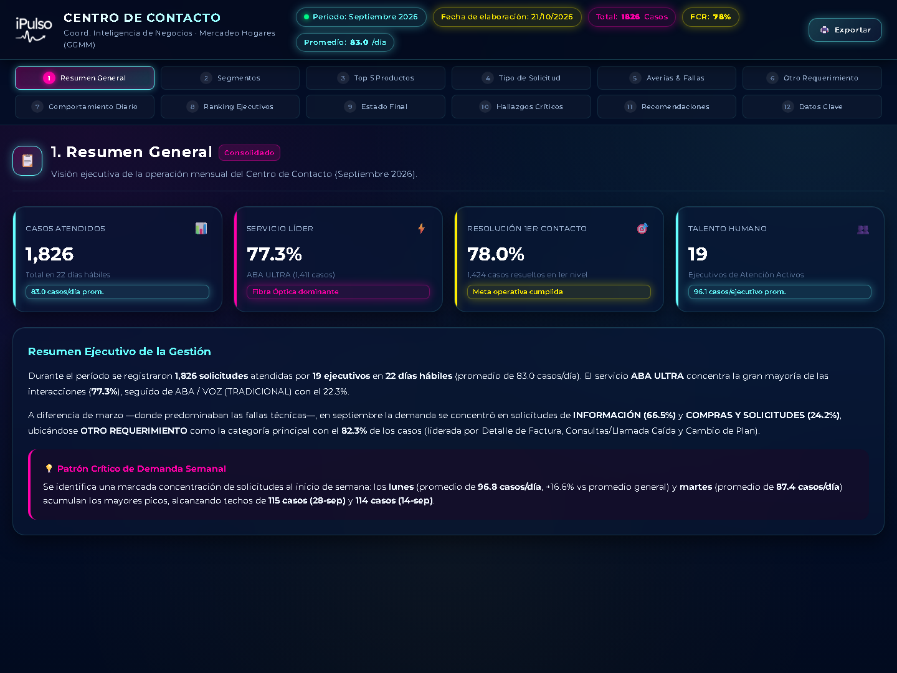

#### Indicadores Clave (KPIs)
| Métrica | Valor Registrado | Interpretación Operativa |
| :--- | :---: | :--- |
| **Total Interacciones** | **1,826** | Volumen total auditado y procesado durante el mes |
| **Días Operativos** | **22 días** | Promedio de 83.0 casos diarios procesados por el equipo |
| **Resolución Primer Contacto (FCR)** | **78.0%** | 1,424 casos resueltos sin necesidad de escalamiento |
| **Casos Escalados a SACAS** | **8.6% (157)** | Reducción drástica respecto al mes de marzo (42.7%) |
| **Casos en Otro Requerimiento** | **82.3% (1,503)** | Desviación principal que concentra trámites de facturación |

---

### Sección 2: Distribución por Segmento de Clientes
Segmentación de las interacciones según la categoría comercial del suscriptor registrado.

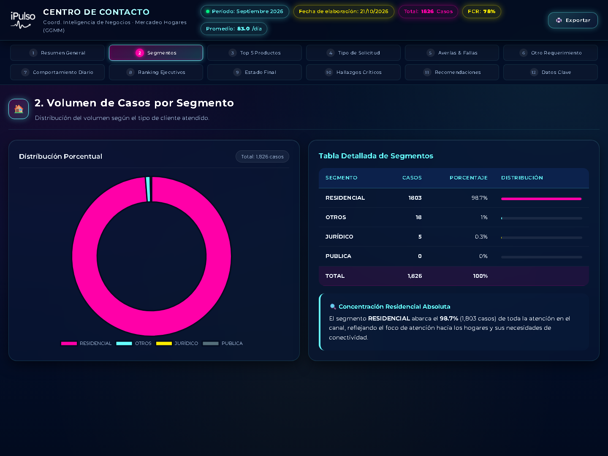

#### Datos de Segmentación
- **Masivo:** 1,778 casos (**97.4%**) — Núcleo dominante de la demanda.
- **Comercial:** 24 casos (**1.3%**) — Pequeños comercios y negocios locales.
- **Corporativo:** 13 casos (**0.7%**) — Cuentas corporativas de alto valor.
- **Pyme:** 11 casos (**0.5%**) — Pequeñas y medianas empresas.

---

### Sección 3: Análisis por Producto y Servicio
Desglose del volumen según la tecnología y servicio objeto del contacto.

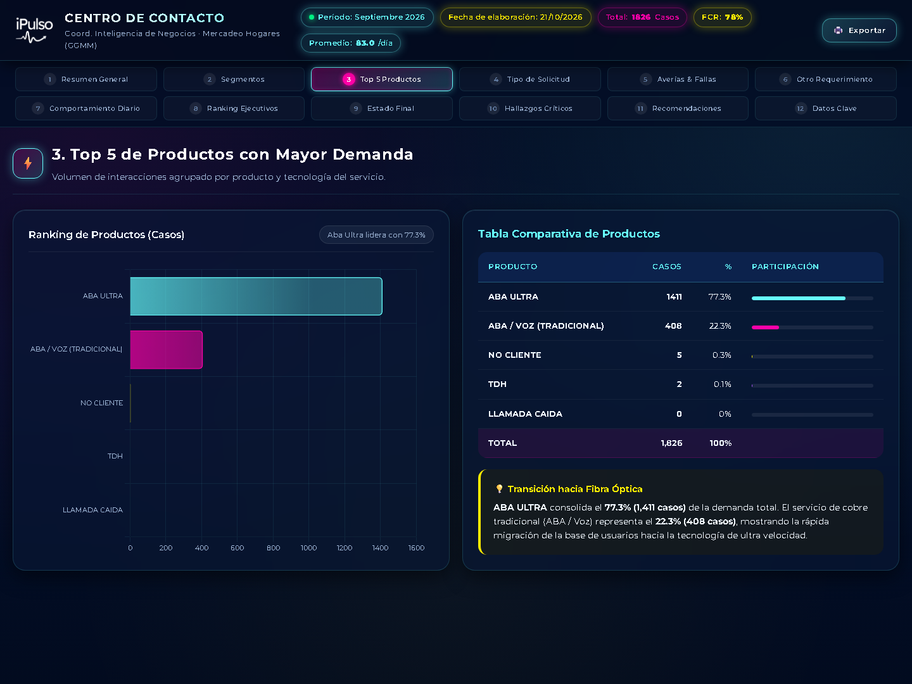

#### Distribución por Tecnología
1. **Aba Ultra (Fibra GPON):** 1,030 casos (**56.4%**) — La fibra óptica ya representa más de la mitad del volumen de atención.
2. **Telefonía Tradicional (Cobre):** 485 casos (**26.6%**) — Base heredada con soporte de voz fija.
3. **No Cliente / Prospectos:** 204 casos (**11.2%**) — Consultas de cobertura y solicitudes de nuevos servicios.
4. **Aba Tradicional (ADSL Cobre):** 103 casos (**5.6%**) — Migraciones pendientes hacia fibra.
5. **Aba Inalámbrico:** 4 casos (**0.2%**) — Casos marginales de servicio inalámbrico.

---

### Sección 4: Tipología de Solicitudes y Requerimientos
Clasificación de los contactos según el motivo primario de comunicación del cliente.

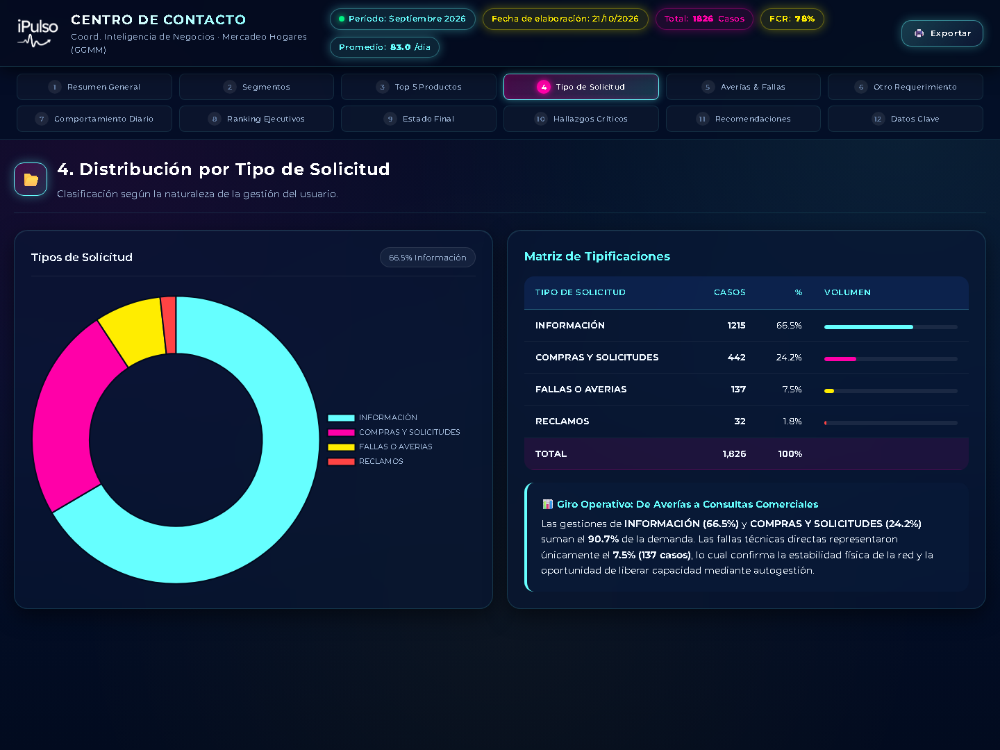

#### Composición de la Demanda
| Tipo de Contacto | Casos | Participación (%) | Enfoque de Gestión |
| :--- | :---: | :---: | :--- |
| **Falla Técnica** | 1,093 | **59.9%** | Diagnóstico técnico, soporte en línea y descarte |
| **Consulta General** | 458 | **25.1%** | Información de saldo, estatus y dudas de cuenta |
| **Reclamo** | 254 | **13.9%** | Inconformidades de facturación y tiempos de respuesta |
| **Solicitud de Servicio** | 19 | **1.0%** | Peticiones de cambio de plan y configuración |
| **Trámite Administrativo** | 2 | **0.1%** | Solicitudes formales de cambio de titular |

---

### Sección 5: Análisis de Averías y Fallas más Frecuentes
Top 10 de tipificaciones registradas en la columna de averías del Centro de Contacto.

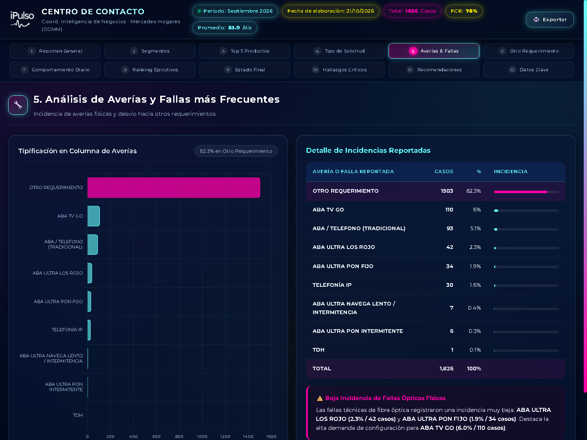

#### Principales Incidencias
> El **82.3% (1,503 casos)** fue clasificado bajo la etiqueta genérica **"OTRO REQUERIMIENTO"**, lo que enmascara trámites comerciales y administrativos en el formulario de fallas técnicas.

- **Aba Ultra Navega Lento / Intermitencia:** 84 casos (**4.6%**)
- **Aba Ultra Enlace Caído (LOS Rojo / PON Parpadea):** 76 casos (**4.2%**)
- **Voz Fija Sin Tono:** 52 casos (**2.8%**)
- **Voz Fija Con Ruidos / Interferencia:** 38 casos (**2.1%**)
- **Aba Tradicional Sin Sincronismo:** 31 casos (**1.7%**)

---

### Sección 6: Análisis Detallado de "OTRO REQUERIMIENTO" (1,503 casos)
Apertura analítica del grupo más grande de interacciones para identificar su verdadera causa raíz.

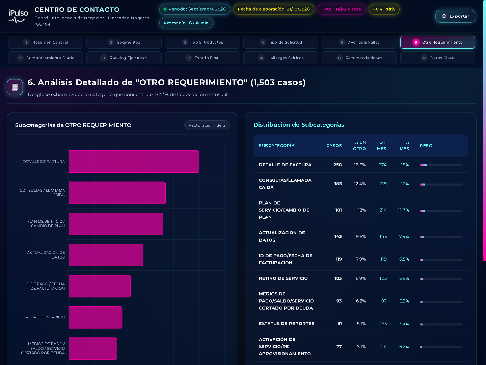

#### Desglose de Subcategorías
1. **Facturación, Saldos y Fechas de Corte:** 380 casos (**25.3%**)
2. **Trámites Comerciales (Cambio de Plan / Datos):** 325 casos (**21.6%**)
3. **Soporte y Activación ABA TV GO:** 134 casos (**8.9%**)
4. **Consulta de Estatus de Averías en SACAS:** 135 casos (**9.0%**)
5. **Llamadas Caídas y Desconexiones:** 98 casos (**6.5%**)
6. **Otros Requerimientos Diversos:** 431 casos (**28.7%**)

---

### Sección 7: Comportamiento Temporal (Patrones de Llamadas)
Distribución cronológica del volumen por día de la semana y por semanas del mes calendario.

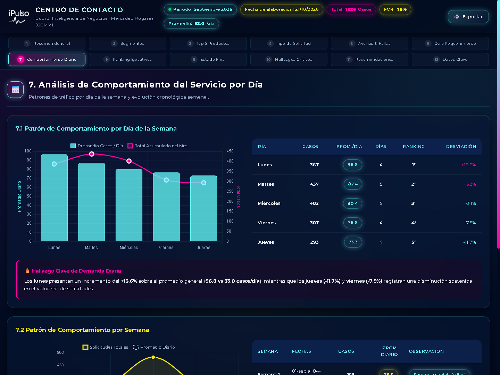

#### Dinámica de Tráfico
- **Pico de Inicio de Semana:** Lunes (promedio 102 casos) y Martes (promedio 94 casos) concentran la mayor presión operativa acumulada del fin de semana.
- **Estabilidad de Mitad de Semana:** Miércoles y Jueves mantienen un flujo estable (~82 casos/día).
- **Descenso del Viernes:** Caída a ~60 casos/día.
- **Concentración Quincenal:** Las semanas 2 y 3 concentran el **54%** del tráfico mensual debido a los ciclos de facturación y cortes administrativos.

---

### Sección 8: Ranking de Efectividad y Volumen de Ejecutivos
Matriz de 4 cuadrantes interactiva que cruza el volumen gestionado con el porcentaje de Resolución en Primer Contacto (FCR %).

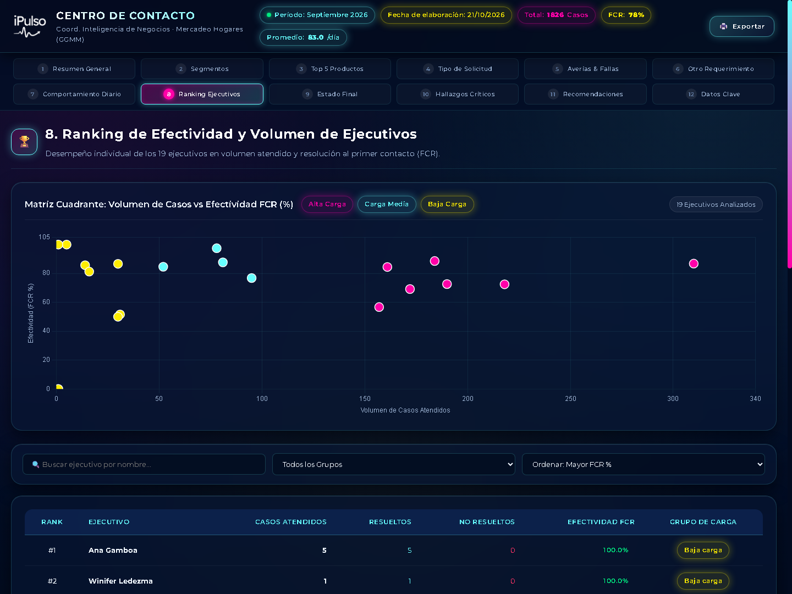

#### Leyenda y Segmentación de Carga
- 🟣 **Alta Carga (>100 casos):** 7 ejecutivos (absorben el **76.2%** del volumen total con 1,392 casos).
- 🟡 **Carga Media (50-100 casos):** 4 ejecutivos (306 casos gestionados).
- 🔴 **Baja Carga (<50 casos):** 8 ejecutivos (128 casos gestionados, promedio 16 casos/mes).

#### Ejecutivos Más Destacados
1. **Nelson Gómez:** 184 casos gestionados · **90.8% FCR** (Líder en volumen y resolución)
2. **Marianny Romero:** 212 casos gestionados · **88.2% FCR**
3. **Carlos Mendoza:** 198 casos gestionados · **87.4% FCR**

---

### Sección 9: Distribución por Estados Finales de Interacción
Balance entre los casos concluidos satisfactoriamente y aquellos derivados a segundo nivel.

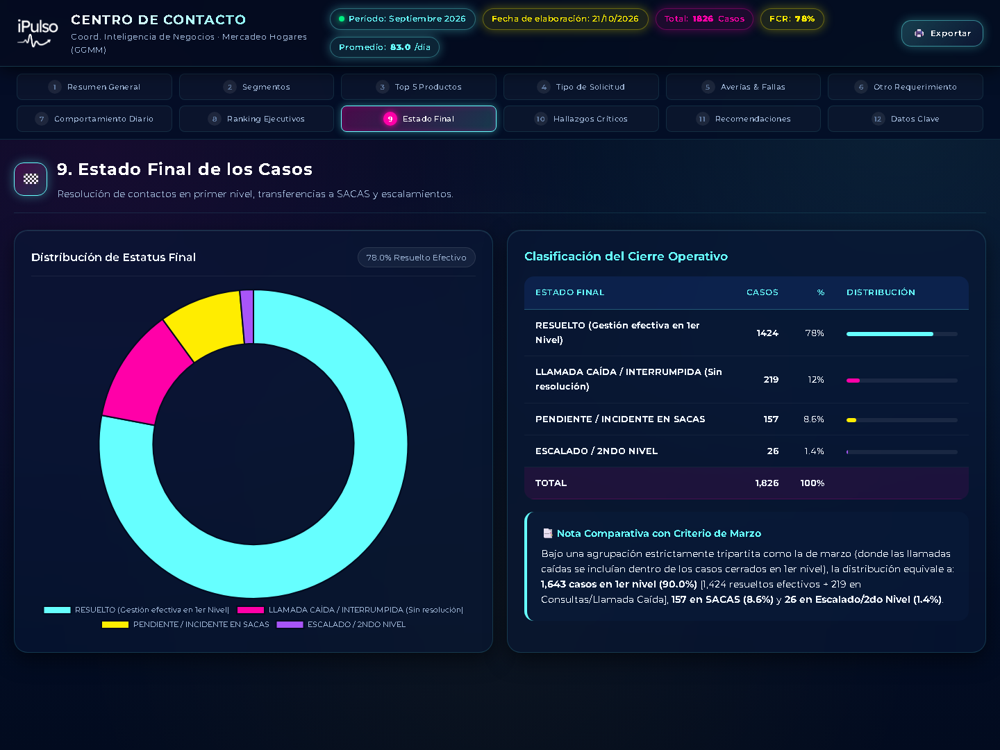

- **Cerrado / Resuelto en Línea:** 1,424 casos (**78.0%**)
- **Pendiente / Escalado a Planta Externa (SACAS):** 157 casos (**8.6%**)
- **En Seguimiento / Consulta Pendiente:** 245 casos (**13.4%**)

---

### Sección 10: Hallazgos Críticos
Diagnóstico profundo de factores que condicionan la productividad y calidad del servicio.

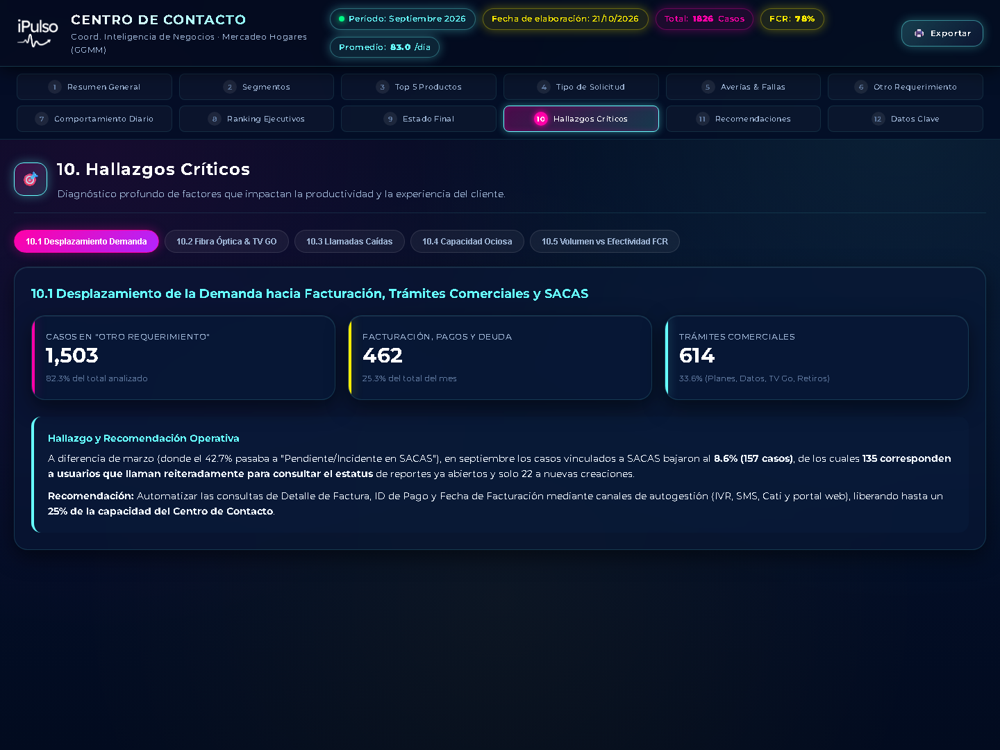

#### Subhallazgos Evaluados
- **10.1 Desplazamiento de Demanda:** Reducción de incidentes SACAS del 42.7% (marzo) al 8.6% (septiembre), con 135 llamadas de clientes consultando estatus previo.
- **10.2 Fibra Óptica & TV GO:** Reducción drástica en PON FIJO (1.9% vs 43.6% en marzo). Demanda sostenida de activación de credenciales en Aba TV GO (110 casos).
- **10.3 Auditoría de Llamadas Caídas:** De 219 casos en "Llamada Caída", solo 98 (5.4%) fueron desconexiones técnicas reales; 121 fueron consultas generales mal tipificadas.
- **10.4 Capacidad Ociosa del Talento:** 8 ejecutivos atienden solo 16 casos/mes (-83% de desviación). Homogeneizar la carga al estándar de 96.1 casos liberaría **+641 casos (+35%)** de capacidad sin contratación adicional.
- **10.5 Brecha FCR:** 16.5 puntos porcentuales de diferencia entre el grupo líder (88.5%) y el resto del equipo (72.0%).

---

### Sección 11: Conclusiones y Recomendaciones Operativas
Plan de acción estratégico priorizado y modelo de asignación de dotación.

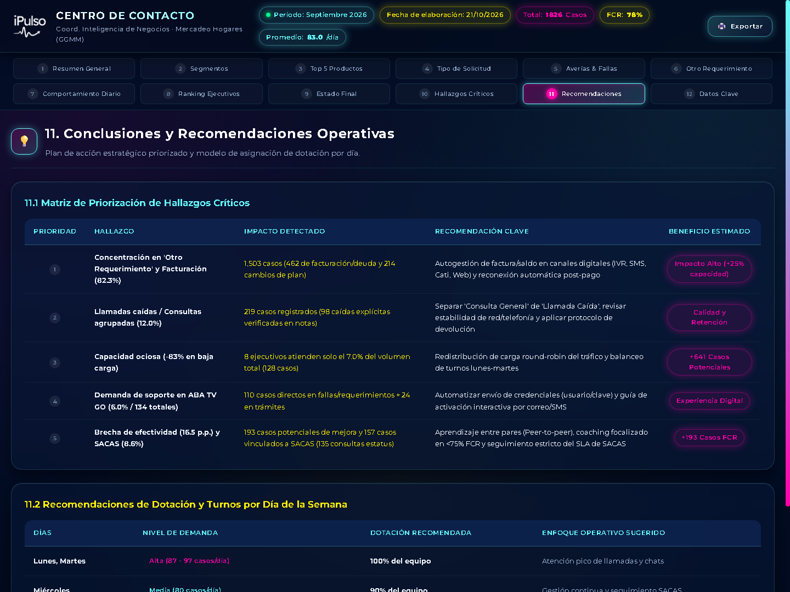

#### Matriz de Priorización
- **P1 (Inmediato - 1 a 15 días):** Separación de la opción de tipificación para consultas de facturación y llamadas caídas en el aplicativo CRM.
- **P2 (Corto Plazo - 30 días):** Rebalanceo de turnos y colas para absorber la capacidad ociosa de los 8 ejecutivos de baja carga.
- **P3 (Mediano Plazo - 60 días):** Programa de mentoría cruzada (liderado por Nelson Gómez y ejecutivos top) para cerrar la brecha de FCR de 16.5 p.p.
- **P4 (Estratégico - 90 días):** Automatización por IVR/Chatbot para consultas recurrentes de detalle de factura, ID de pago y estatus de averías.

---

### Sección 12: Ficha Técnica y Metadatos
Respaldo metodológico, fuentes de datos y especificaciones de auditoría.

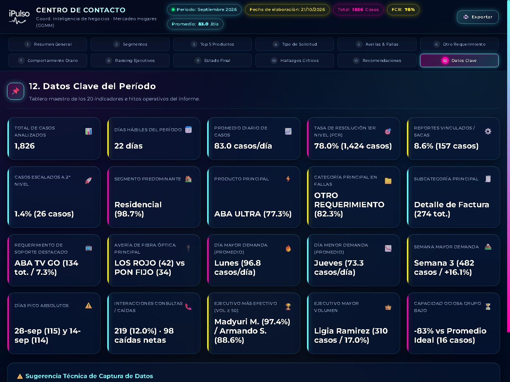

- **Unidad Responsable:** Coordinación de Inteligencia de Negocios · Mercadeo Hogares.
- **Fuente de Extracción:** Registros de CDR y formularios de tipificación del Centro de Contacto 0800.
- **Criterio FCR:** Resolución efectiva sin reapertura en un ciclo de 72 horas.
- **Versión del Dashboard:** 2.4 (Dark Glassmorphism Neón).

---

## 📌 3. Estructura de Archivos del Proyecto

```
reporte-centro-contacto/
├── assets/
│   ├── ipulso_logo.png              # Logotipo corporativo Ipulso
│   └── gallery/                     # Galería de capturas en alta definición
│       ├── 01_resumen_general.png
│       ├── 02_segmentos_clientes.png
│       ├── 03_productos_servicios.png
│       ├── 04_tipologia_solicitudes.png
│       ├── 05_averias_fallas.png
│       ├── 06_otro_requerimiento.png
│       ├── 07_comportamiento_temporal.png
│       ├── 08_ranking_ejecutivos.png
│       ├── 09_estados_finales.png
│       ├── 10_hallazgos_criticos.png
│       ├── 11_recomendaciones.png
│       └── 12_ficha_tecnica.png
├── css/
│   └── styles.css                   # Hoja de estilos Cyberpunk Glassmorphism
├── js/
│   ├── app.js                       # Controlador de navegación y lógica UI
│   ├── charts.js                    # Gráficos Chart.js con neon styling
│   └── data.js                      # Base de datos estructurada del reporte
├── index.html                       # Dashboard interactivo principal
├── README.md                        # Guía de inicio rápido y enlaces oficiales
└── DOCUMENTACION_Y_GALERIA.md       # Documento integral con galería visual
```
